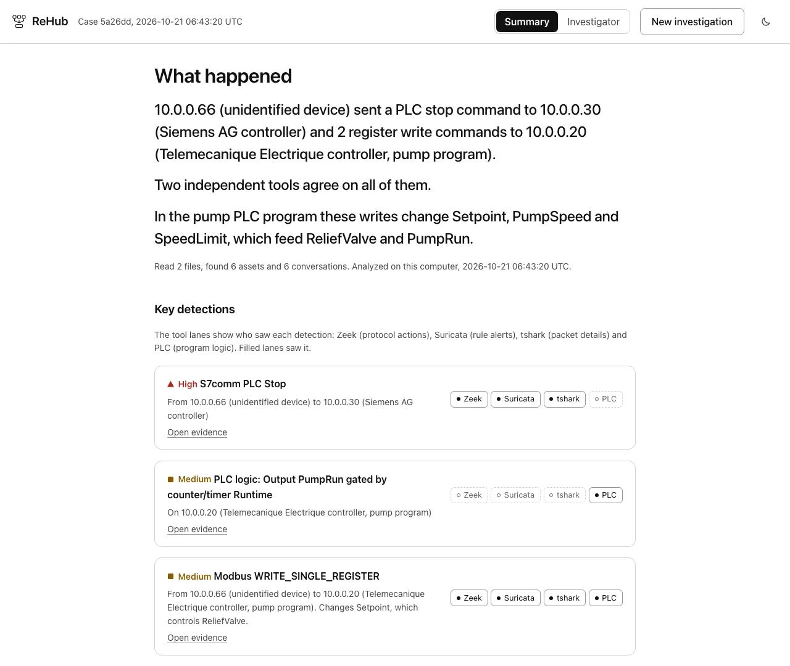
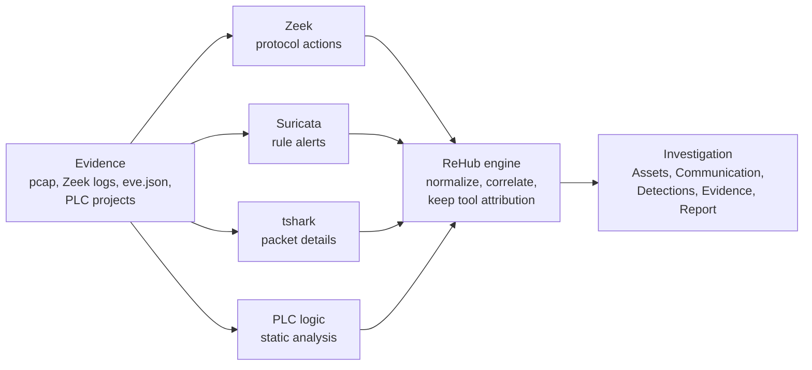

# ReHub

[](https://github.com/Ani07-05/rehub-engine/actions/workflows/ci.yml)
[](LICENSE)


**Drop in OT evidence, get an investigation you can explain.**
ReHub runs Zeek, Suricata and tshark on a capture, joins their output with your PLC logic, and answers in plain language first, with the proof one click away. It runs on your own machine and never sends anything out.

<picture>
  <source media="(prefers-color-scheme: dark)" srcset="site/img/summary-dark.webp">
  
</picture>

[Docs](https://rehub-engine.vercel.app/docs/) | [Site](https://rehub-engine.vercel.app) | [Install](#install) | [Security model](#security-model) | [Develop](#develop)

Status: work in progress, aimed at Black Hat Arsenal. Engine, CLI, web UI, report, installer, CI and the published multi-architecture image work (see [`docs/STATUS.md`](docs/STATUS.md)).

## How it works



1. **Ingest.** Files are identified by content, fingerprinted (SHA-256) and stored by hash. Bundles are unpacked with bomb limits.
2. **Run the tools.** Zeek, Suricata and tshark run on the capture, inside the offline container.
3. **Normalize.** Each tool's output becomes one common event schema, tagged with the tool and the file it came from.
4. **Correlate.** Events are merged by flow (Community ID) and Modbus transaction id, so one command seen by two tools is one detection with two witnesses.
5. **Join the PLC logic.** Register writes are matched to PLC variables, the logic that reads them and the outputs they drive.
6. **Explain.** Plain-language answer first, then every claim links back to the file, line and packets behind it.

## What you get

| | |
| --- | --- |
| **Plain-language answer** | Demo case: `10.0.0.66 (unidentified device) sent a PLC stop command to 10.0.0.30 (Siemens AG controller) and 2 register write commands to 10.0.0.20 ... Two independent tools agree on all of them.` |
| **Network x PLC logic** | A Modbus register write is traced to the PLC variable it overlaps, the logic that reads it and the outputs it drives. The address mapping is shown as an assumption. |
| **What was written** | Each Modbus write shows the register and the value it set, taken from the Zeek or Suricata data. |
| **Tool lanes** | Every detection shows which tools saw it (Zeek, Suricata, tshark, PLC logic), so agreement between independent tools is visible. |
| **Two reading modes** | Investigator (default) for the detail, optional Summary for the story, on the same facts. Light and dark themes. |
| **One flow** | Assets, Communication, Detections, Evidence, Report, each with the question it answers and what the engine did. |
| **Honest limits** | Missing tools, capture loss, ambiguous hardware addresses and unparsed files are listed under "What we could not verify". ATT&CK for ICS techniques are candidates, never verdicts. |
| **Evidence you can defend** | Every file is SHA-256 fingerprinted, tool output names the capture it came from, and each detection links to the file, line and packets behind it. The report downloads as one offline HTML file with no scripts. |

### Inputs

| Type | Notes |
| --- | --- |
| Captures | pcap, pcapng |
| Zeek logs | JSON and TSV |
| Suricata | `eve.json` |
| PLC projects | Structured Text, PLCopen XML, Rockwell L5X |
| Bundles | zip or tar of the above |
| Anything else | stored and listed as not analyzed |

One sample of each is in [`samples/`](samples/).

## Install

Needs Docker (Desktop or Engine) with Compose v2.

```sh
curl -fsSL https://rehub-engine.vercel.app/install.sh | sh
```

About 280 MB, under a minute on a normal connection. The script is short; [read it first](scripts/install.sh). Tested end to end from a clean home against the published image.

From a checkout:

```sh
./scripts/install.sh --local      # builds the image
./scripts/install.sh              # pulls the published image
```

It starts two containers from [`compose.yml`](compose.yml):

| Container | Role | Hardening |
| --- | --- | --- |
| **engine** | parses the evidence | no route out (no internet, no name resolution), read-only root, all capabilities dropped, no-new-privileges, memory and process limits, publishes no ports |
| **gateway** | ~50 line TCP forwarder | publishes the UI on `127.0.0.1` only |

Then it runs the doctor, prints the address and opens it. Other flags: `--update`, `--status`, `--uninstall [--purge]`, `--port N`, `--auth`.

## Use it

Open http://localhost:8080. A start screen checks Storage, Zeek, Suricata and tshark (with a self-test on a built-in capture), then you press Enter. Drop evidence, or press **Try the demo** for a built-in pump station case with a rogue device.

Sign-in is off by default because ReHub is local only. `install.sh --auth`, `REHUB_TOKEN` or `rehub serve --auth` turn on an access token (a sign-in link is printed; the token becomes an HttpOnly cookie).

From a terminal (the tools are inside the image):

```sh
docker run --rm --network none --read-only --tmpfs /tmp --user "$(id -u):$(id -g)" \
  -v "$PWD/fixtures:/in:ro" -v "$PWD/data:/data" rehub:dev \
  rehub --data /data analyze /in/ot-demo.pcap /in/plc/pump.st --plc-ip pump.st=10.0.0.20
```

| Command | Does |
| --- | --- |
| `analyze` | run an investigation on files |
| `show <id>` | print an investigation |
| `doctor [--quick]` | check the tools and self-test |
| `serve [--auth]` | start the web UI and API |
| `token [--rotate]` | print or rotate the sign-in token |
| `gateway` | the loopback forwarder used by compose |

## Tools it wraps

ReHub wraps these and does not replace them.

| Tool | Version | Used for |
| --- | --- | --- |
| [Zeek](https://zeek.org) | 8.0.10 | protocol actions, with the CISA ICSNPP S7comm and EtherNet/IP plugins |
| [Suricata](https://suricata.io) | 8.0.7 | rule alerts and Modbus transactions |
| [tshark](https://www.wireshark.org/docs/man-pages/tshark.html) | 4.4.19 | packet details |

Emerging Threats rules are not bundled.

## Security model

- Loopback bind and a Host allowlist against DNS rebinding.
- An `X-Rehub` header plus Origin check on every change.
- Evidence is only ever served as a download; every file-derived string is set as text, never HTML.
- Strict CSP with no inline script or style.
- Upload size caps, sanitized names, zip/tar/gzip bomb limits.
- XML DTD and entity rejection for PLC files.

See [`docs/STATUS.md`](docs/STATUS.md) for the full list and the known limits.

## Develop

```sh
uv sync
uv run pytest                 # unit, API, UI logic (needs node), container tests if the image exists
uv run ruff check . && uv run ruff format --check . && uv run mypy
docker build -f docker/Dockerfile -t rehub:dev .
./scripts/regen-fixtures.sh   # after changing tool output or the demo capture
./scripts/real-pcap-smoke.sh  # downloads five small public ICS captures and runs them
./scripts/make-samples.sh     # rebuilds samples/ (one file of each evidence type)
```

<details>
<summary>Source layout</summary>

```
src/rehub/
  sniff.py ingest.py     identify evidence by content, store it by hash, unpack bundles safely
  tools.py doctor.py     Zeek / Suricata / tshark runners and the self-test
  adapters/              tool output to one Event schema
  communityid.py         Community ID v1 (verified against Zeek and Suricata)
  correlate.py model.py  assets, flows, detections, corroboration, ATT&CK candidates
  plc/                   PLC project parsing, static analysis, register-to-variable linking
  pipeline.py cli.py     upload to investigation, persistence, CLI
  api.py auth.py drill.py local HTTP API, optional token, evidence drill-down
  gateway.py             tiny TCP forwarder used by the compose stack
  ui/                    web UI: plain HTML, CSS and JS, no build step
docker/ compose.yml      tool image and hardened stack
site/ vercel.json        docs and landing page, and their deployment config
fixtures/                synthetic OT capture, real tool output, PLC projects
samples/                 one file of each evidence type to try uploading
PRODUCT.md DESIGN.md     product context and design system
```

</details>

## Docs

Published at https://rehub-engine.vercel.app/docs/ (overview, install, usage, reference, how it works), with real screenshots. Source in [`site/docs/`](site/docs/). Arsenal submission text, demo script and checklist: [`docs/ARSENAL.md`](docs/ARSENAL.md).

## License

[MIT](LICENSE)
